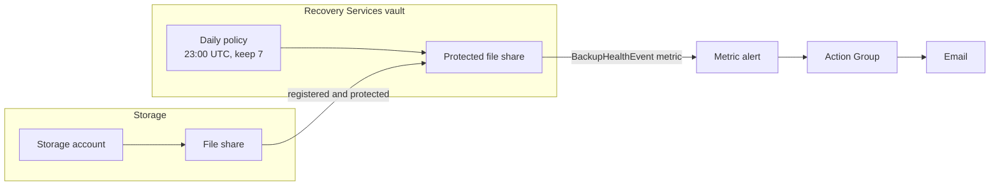
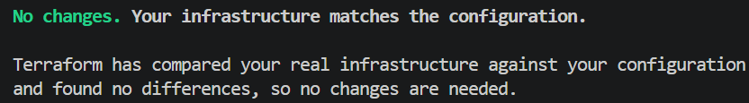
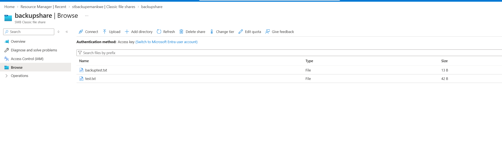
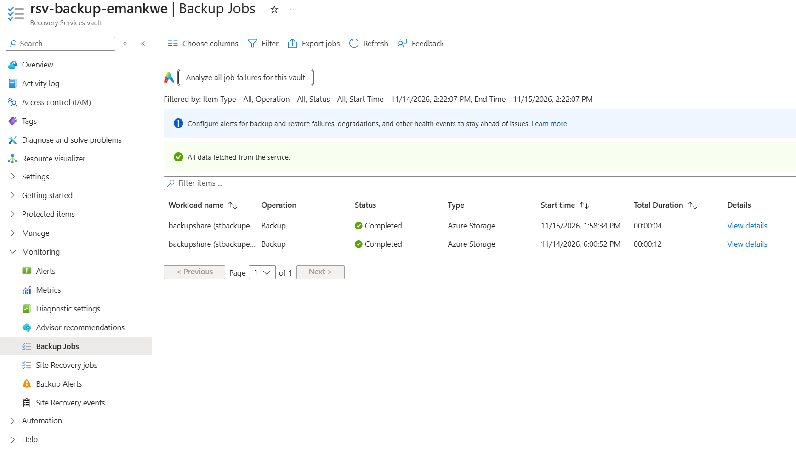
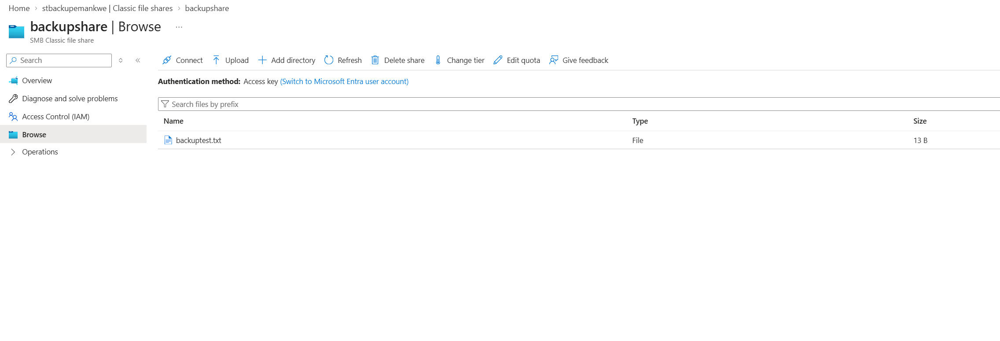
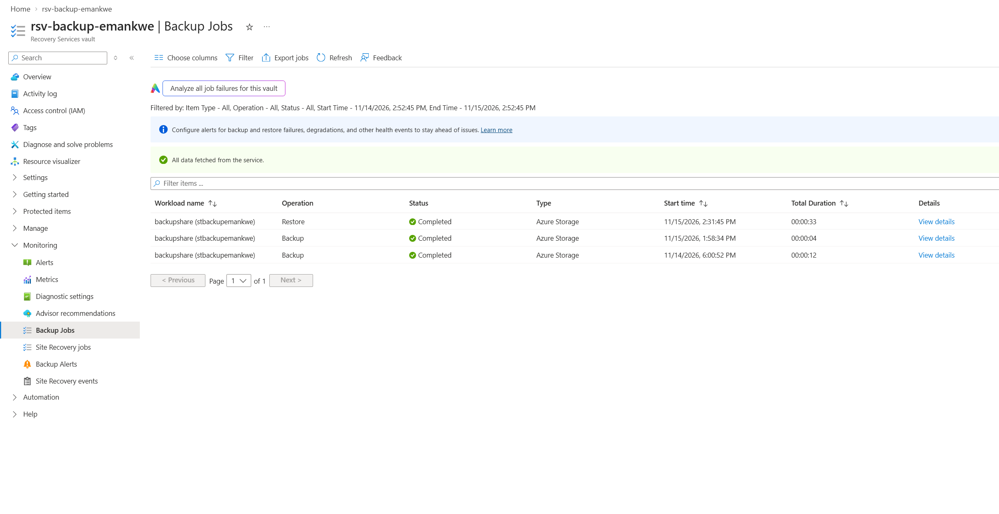
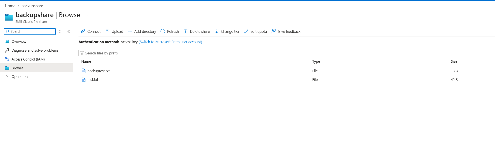
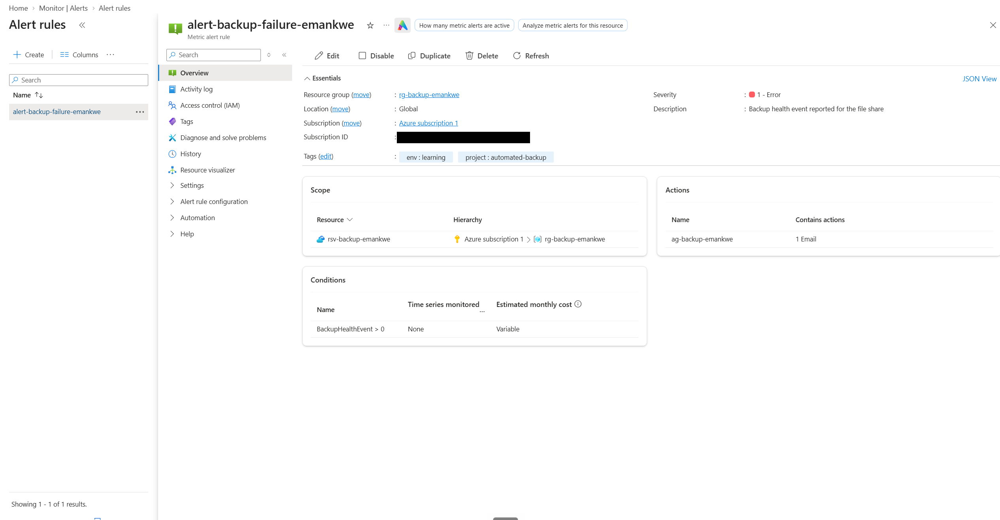

# Azure-Automated-Backup-System-with-Terraform
I built a system that backs up an Azure file share every night, keeps the last 7 backups, and emails the owner when the vault reports a backup health problem. Everything is built with Terraform, and I proved it works by deleting a file and restoring it from a backup.

<!--
### 🎬 Video Walkthrough

[Watch the project walkthrough](PASTE-LOOM-LINK-HERE)


---

### Result at a glance

| | |
|---|---|
| **What I built** | A resource group, a storage account with a file share, a Recovery Services vault (locally redundant), a daily backup policy (23:00 UTC, 7 backups kept), the share registered and protected by that policy, an email Action Group, and a metric alert on backup health events |
| **Proof it works** | `terraform plan` reported "No changes", the policy ran every night at 23:00 UTC, and a test file I deleted came back from the backup with identical content (screenshots 01 to 06) |
| **Not tested yet** | The alert email itself. The alert rule exists and points at the Action Group (screenshot 07), but no failing backup has fired it |
| **Cost to run** | Not measured yet. It grows with the amount of data backed up. Check Cost Management for real figures |
| **Cleanup** | Not done. Do not run `terraform destroy` straight away, see Destroying the project |
| **Tools** | Terraform, Azure Backup, Recovery Services vault, Azure Files, Azure Monitor, Azure CLI |

---

## Project Overview

### What this project does, in plain English

Think of it like photocopying important papers every night and keeping the last week of copies in a safe. The vault is the safe, the policy is the nightly schedule, and the alert is a doorbell that rings if the copier jams.

Where the analogy breaks down: a copy you have never tried to read is not proven. A backup only counts once you have restored from it, which is why this project includes a restore test. The alert also only rings for health events the vault reports. I have not made one fire yet.

### Why it matters

Files get deleted by mistake or overwritten. A scheduled backup with a tested restore means you can get yesterday's version back instead of losing the work. Automating it with Terraform means the same setup can be rebuilt from code, and every setting is a variable instead of a hardcoded value.

### What gets built

| Component | Built with |
|---|---|
| Resource group `rg-backup-<name>` | Terraform |
| Storage account `stbackup<name>` (Standard, LRS) | Terraform |
| File share `backupshare` (5 GB quota) | Terraform |
| Recovery Services vault `rsv-backup-<name>` (locally redundant) | Terraform |
| Backup policy `policy-daily-<name>` (daily 23:00 UTC, keep 7) | Terraform |
| Storage account registered with the vault, file share protected | Terraform |
| Action Group `ag-backup-<name>` (email) | Terraform |
| Metric alert `alert-backup-failure-<name>` | Terraform |

### Skills demonstrated

- Infrastructure as Code with Terraform on Azure (azurerm 4.x)
- Moving every tunable setting into variables, with validation blocks for time, retention, severity and name length
- Azure Backup for Azure Files: vault, policy, container registration, protected item
- Azure Monitor Action Groups and metric alerts
- Running and checking a backup and a restore from the Azure CLI
- Verifying a restore by comparing file contents, not only file names
- Reading provider and CLI errors and fixing them (see Troubleshooting)

---

## Project Structure

```text
azure-automated-backup-system/
├── README.md
├── versions.tf                  # Terraform and provider version rules
├── providers.tf                 # how Terraform connects to Azure
├── main.tf                      # the resources
├── variables.tf                 # input variables
├── outputs.tf                   # values printed after apply
├── .terraform.lock.hcl          # pins the provider version
├── terraform.tfvars.example     # placeholders only
├── .gitignore                   # excludes terraform.tfvars, state, plans, .terraform/
└── images/                      # evidence screenshots
```

---

## Architecture



### How it works

1. **Register.** The storage account is registered with the vault, so the vault is allowed to back it up.
2. **Protect.** The file share is attached to the daily policy. This turns backups on.
3. **Back up.** Every night at 23:00 UTC the vault takes a snapshot of the share. The policy's retention count (7 by default) sets how many daily backups are kept.
4. **Watch.** The vault reports a `BackupHealthEvent` metric. The alert fires when an event is not `Healthy`.
5. **Notify.** The alert calls the Action Group, which emails the owner.
6. **Restore.** Any recovery point can be restored, either the whole share or a single file.

### Key terms

| Term | What it means |
|---|---|
| **Recovery Services vault** | The Azure resource that stores backups and backup policies |
| **Backup policy** | When to back up and how long to keep each backup |
| **Recovery point** | One saved backup. A restore picks one |
| **Container** | The storage account, once it is registered with the vault |
| **Protected item** | The file share, once it is attached to a policy |
| **Action Group** | A reusable list of who gets notified when an alert fires |
| **Metric alert** | A rule that watches a number and fires when it crosses a line |
| **LRS** | Locally redundant storage: 3 copies in one datacenter, lowest cost |
| **Soft delete** | Deleted backup data is kept for a period, which can block destroying the vault |
| **Terraform state** | Terraform's record of what it built. Never committed, it can hold secrets |

---

## Prerequisites

| Requirement | Version used |
|---|---|
| Azure subscription (active, Contributor) | Pay-as-you-go |
| Terraform | 1.16.6 (azurerm provider 4.81.0). The code requires 1.5 or newer |
| Azure CLI | 2.90.0 |
| An email address for alerts | any |

**Time and cost:** see the footer. Cost is not measured yet.

---

## Variables

Required (no default):

| Variable | Description |
|---|---|
| `yourname` | Short lowercase suffix for resource names. Letters and numbers only. It is part of the storage account name, so keep it at 15 characters or fewer |
| `alert_email` | Address that receives backup alerts |

Optional (defaults in `variables.tf`):

| Variable | Default | Description |
|---|---|---|
| `location` | `East US` | Azure region |
| `tags` | project and env tags | Tags applied to all resources |
| `backup_time` | `23:00` | Daily backup time (HH:MM, validated) |
| `backup_timezone` | `UTC` | Timezone of the schedule |
| `daily_retention_count` | `7` | Daily backups to keep (1 to 200, validated) |
| `file_share_name` | `backupshare` | Name of the file share |
| `file_share_quota_gb` | `5` | Share size limit in GB |
| `storage_account_tier` | `Standard` | Storage account tier |
| `storage_replication_type` | `LRS` | Storage replication |
| `vault_storage_mode` | `LocallyRedundant` | Where the vault keeps backups. Cannot change once items are protected |
| `alert_severity` | `1` | Alert severity (0 to 4, validated) |
| `alert_frequency` | `PT5M` | How often the alert is evaluated |
| `alert_window_size` | `PT15M` | Alert look-back window |
| `action_group_short_name` | `backupalert` | Action group short name (12 characters max, validated) |

Outputs: `resource_group_name`, `storage_account_name`, `recovery_vault_name`, `backup_policy_id`. Run `terraform output` to print them.

---

## Naming Conventions Used

| Item | Name |
|---|---|
| Resource group | `rg-backup-<name>` |
| Storage account | `stbackup<name>` |
| File share | `file_share_name` variable (default `backupshare`) |
| Recovery Services vault | `rsv-backup-<name>` |
| Backup policy | `policy-daily-<name>` |
| Action Group | `ag-backup-<name>` |
| Metric alert | `alert-backup-failure-<name>` |

---

## Project Steps

### Step 1: Log in to Azure
On WSL there is no browser, so I use device code. Terraform also needs a Microsoft Graph token, so I request that scope:

```bash
az login --use-device-code --scope "https://graph.microsoft.com/.default"
```

Then I set the subscription ID. It is not stored in the code, and it has to be set again in every new terminal:

```bash
export ARM_SUBSCRIPTION_ID=$(az account show --query id -o tsv)
```

### Step 2: Create terraform.tfvars
```bash
cp terraform.tfvars.example terraform.tfvars
```
Then I set `yourname`, `alert_email` and `location`. `terraform.tfvars` stays out of Git, and `terraform.tfvars.example` is committed with placeholders.

### Step 3: Deploy
```bash
terraform init
terraform fmt
terraform validate
terraform plan
terraform apply
```
I read the plan before typing `yes`. After the deployment, a second `terraform plan` reports no differences, because the real setup matches the code:



### Step 4: Check the scheduled backups
The policy runs at 23:00 UTC. The job list shows one completed Backup job per night:

```bash
az backup job list -g <rg> -v <vault> -o table
```

### Step 5: Restore test
The goal is to prove a deleted file comes back. First I save the names I will reuse. `SHARE` is the `file_share_name` value:

```bash
RG=$(terraform output -raw resource_group_name)
SA=$(terraform output -raw storage_account_name)
VAULT=$(terraform output -raw recovery_vault_name)
SHARE=backupshare
```

**5a. Upload a test file.** The date in the file makes its content unique.

```bash
echo "restore test $(date)" > test.txt
az storage file upload --account-name $SA --share-name $SHARE --source test.txt --path test.txt
az storage file list --account-name $SA --share-name $SHARE -o table
```



**5b. Run a backup now.** The scheduled backup would run later, so I start one by hand. First I get the container and item names:

```bash
az backup item list -g $RG -v $VAULT --backup-management-type AzureStorage --workload-type AzureFileShare -o table
```

```bash
CONTAINER="<Container name from the output>"
ITEM="<Name from the output>"
az backup protection backup-now -g $RG -v $VAULT -c "$CONTAINER" -i "$ITEM" --backup-management-type AzureStorage --workload-type AzureFileShare
az backup job list -g $RG -v $VAULT -o table
```
The command returns at once with the job `InProgress`. I waited until the Backup job said `Completed`. The portal shows times in local time, so 1:58 PM is 18:58 UTC.



**5c. Delete the file.**

```bash
az storage file delete --account-name $SA --share-name $SHARE --path test.txt
```



**5d. Restore it.** I list the recovery points and pick the one taken after the upload:

```bash
az backup recoverypoint list -g $RG -v $VAULT -c "$CONTAINER" -i "$ITEM" --backup-management-type AzureStorage --workload-type AzureFileShare -o table
RP="<Name of the newest recovery point>"
az backup restore restore-azurefiles -g $RG -v $VAULT -c "$CONTAINER" -i "$ITEM" -r $RP --restore-mode OriginalLocation --resolve-conflict Overwrite --source-file-type File --source-file-path test.txt
az backup job list -g $RG -v $VAULT -o table
```
Only `test.txt` is restored, so the other file in the share is not touched. The Restore job finished in 33 seconds:



**5e. Check it is the same file.** A matching name is not enough, so I download the restored file and compare it to the original:

```bash
mkdir -p restored
az storage file download --account-name $SA --share-name $SHARE --path test.txt --dest restored
diff test.txt restored/test.txt && echo IDENTICAL
```
`--dest` is a folder, not a file name. The file is back in the share:



`diff` printed `IDENTICAL`. I then deleted the local `test.txt` and the `restored/` folder.

### Step 6: Check the alert rule
In the portal under Monitor, Alerts, Alert rules, the rule `alert-backup-failure-<name>` exists. It watches the vault, fires when `BackupHealthEvent` is greater than 0 and the status is not `Healthy`, has severity 1, and calls the Action Group, which sends one email.



This shows the rule is set up. It does not prove an email arrives, because no backup has failed. That test is listed under next steps.

---

## Destroying the project

Do not run `terraform destroy` straight away. The vault has soft delete enabled (Azure no longer allows turning it off) and the file share has a backup item, so the vault cannot be removed until protection is stopped and its backup data is deleted. Remove those first, then destroy. I have not run a teardown for this project yet.

---

## Results

| Check | Result |
|---|---|
| Code passes `terraform fmt` and `terraform validate` | ✅ Done |
| Deployed resources match the code (`terraform plan`) | ✅ Done, "No changes" (screenshot 01) |
| Daily schedule runs | ✅ Done, one Completed Backup job per night at 23:00 UTC |
| Manual backup | ✅ Done, Completed in 4 seconds (screenshot 03) |
| File deleted from the share | ✅ Done (screenshot 04) |
| File restored from a recovery point | ✅ Done, Restore Completed in 33 seconds (screenshots 05 and 06) |
| Restored content matches the original | ✅ Done, `diff` printed `IDENTICAL` |
| Alert rule exists and points at the Action Group | ✅ Done (screenshot 07) |
| Alert email delivered | ⬜ Not tested yet |
| Teardown verified | ⬜ Not done yet |
| Cost measured | ⬜ Not done yet |

---

## Security Decisions

- **Secrets and state out of Git.** `terraform.tfvars`, state files, saved plans and `.terraform/` are in `.gitignore`. Never commit state: it can contain secrets.
- **Subscription ID not in code.** It is passed through the `ARM_SUBSCRIPTION_ID` environment variable.
- **Alert email is a variable.** The example file holds placeholders only.
- **Screenshots checked before committing.** The subscription ID is blacked out in the alert rule screenshot, and the portal bar that shows my account email is cropped out of all of them.
- **Known gaps.** The storage account still allows public network access, storage key access and anonymous blob access, which are Azure defaults. None are needed for a file share backup, and hardening them is listed under next steps.

---

## Troubleshooting / Common Issues

| Issue | Cause | Fix |
|---|---|---|
| `az login` has no browser to open on WSL | WSL cannot launch the Windows browser | `az login --use-device-code --scope "https://graph.microsoft.com/.default"` |
| Terraform cannot find the subscription | `ARM_SUBSCRIPTION_ID` is not set in this terminal | `export ARM_SUBSCRIPTION_ID=$(az account show --query id -o tsv)` |
| `az storage file ...` prints "no credentials provided" | A notice, not an error. The CLI looked up the storage key itself | Ignore it, or add `--auth-mode login` if your account has a storage data role |
| Job shows `InProgress` right after `backup-now` or the restore | The command only starts the job | Wait and run `az backup job list` again until it says `Completed` |
| `[Errno 2] No such file or directory: 'restored.txt/test.txt'` | `--dest` on `az storage file download` is a folder, not a file name | `mkdir restored`, then use `--dest restored` |
| A command fails with strange text such as `-o tableaz storage ...` | Two commands were pasted joined, or one was split over lines. A line break ends a command | Run one command at a time, each on one line |
| The vault cannot be deleted by `terraform destroy` | Soft delete is on and the share still has a backup item | Stop protection and delete the backup data first, then destroy |
| A soft delete argument was rejected as deprecated | Argument names changed in azurerm 4.x | Check names with `terraform providers schema -json` before using them |

---

## Key Takeaways

- A backup is not proven until you restore from it. The restore test is the real result of this project.
- Compare contents, not names. `diff` on the restored file is a stronger check than seeing the file reappear.
- The Azure CLI starts backup and restore jobs and returns at once. Check the job list before moving on.
- Check argument names against the provider schema, not from memory.
- Put every tunable value in a variable, and validate the ones that can break the deployment.
- Say plainly what was not tested. The alert rule exists, but I have not seen it fire.

### What I would do next

- Test the alert end to end: confirm the Action Group email is verified, then cause a backup health event and see the email arrive.
- Add a `file_share_name` output so the restore steps do not hardcode the share name.
- Add validation on `yourname`, because it becomes part of the storage account name.
- Harden the storage account: disable anonymous blob access, and restrict network access.
- Move Terraform state to a remote backend with locking, and run `plan` in a pipeline on pull requests.
- Run and document a full teardown, including stopping protection and clearing soft deleted backup data.
- Add a `name_prefix` variable for the resource names. It changes names, so it forces replacement.

---

## Reference

- [Azure Backup for Azure file shares](https://learn.microsoft.com/azure/backup/azure-file-share-backup-overview)
- [Restore Azure file shares with the CLI](https://learn.microsoft.com/azure/backup/restore-afs-cli)
- [Azure Monitor Action Groups](https://learn.microsoft.com/azure/azure-monitor/alerts/action-groups)
- [Terraform azurerm provider](https://registry.terraform.io/providers/hashicorp/azurerm/latest/docs)

---

**Author:** Manuel Yannick Armah

**Project:** Azure Automated Backup System with Terraform

**Difficulty:** Beginner

**Time to Complete:** 1 - 3 hours
